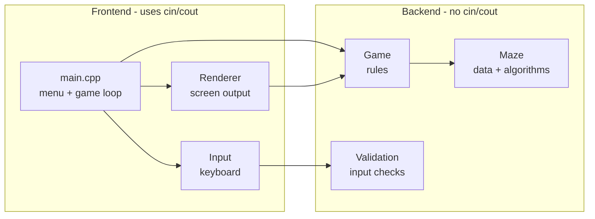
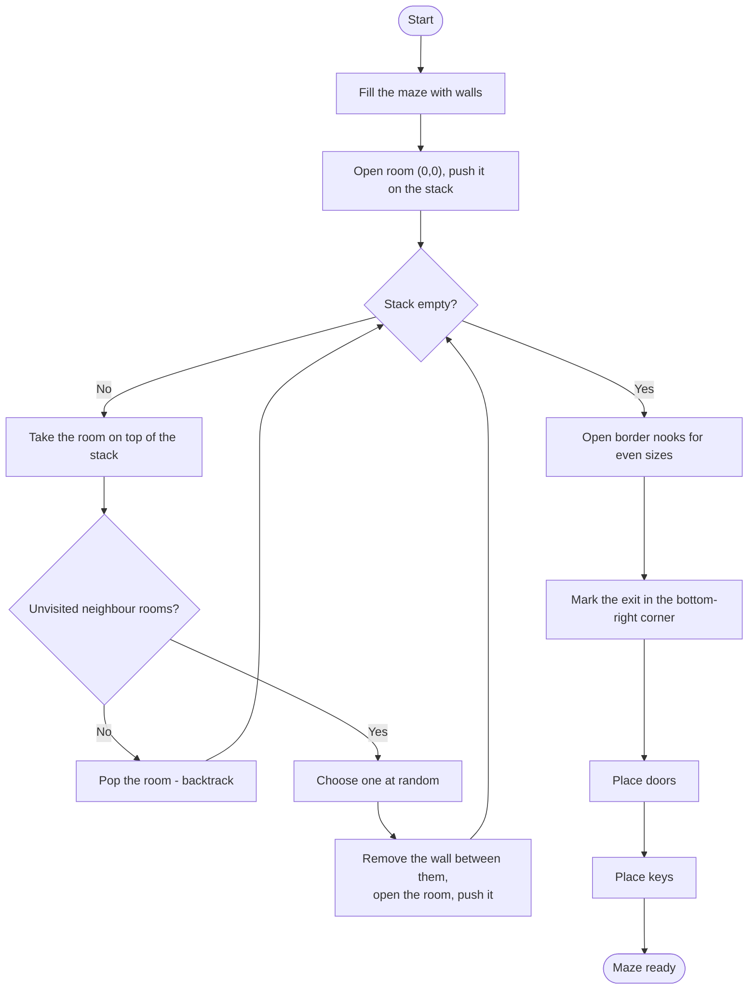
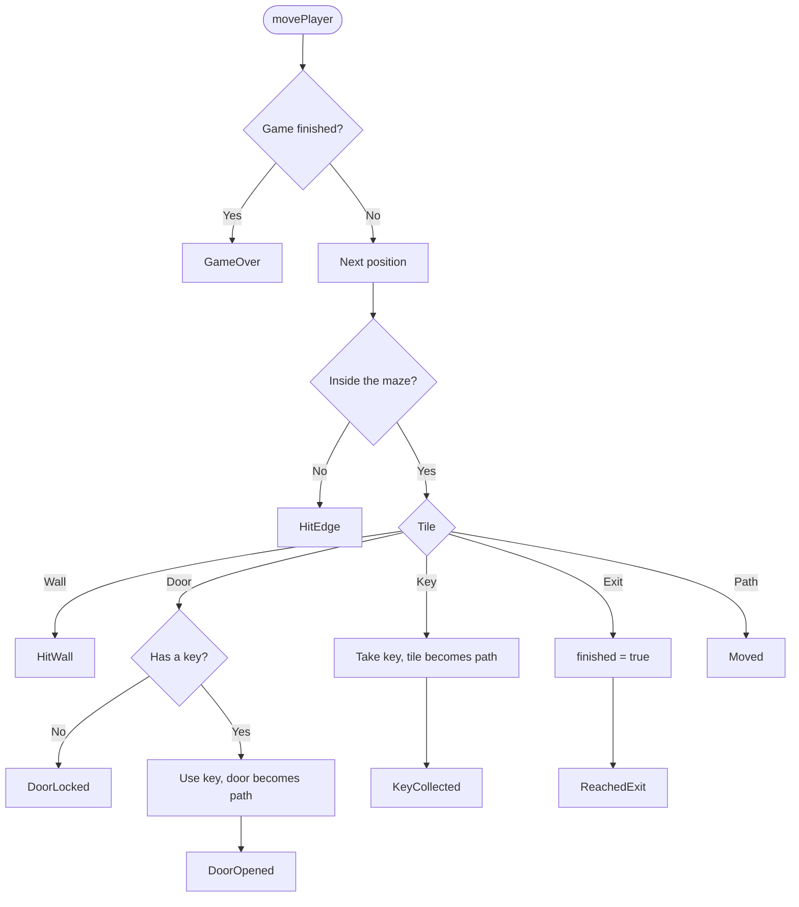
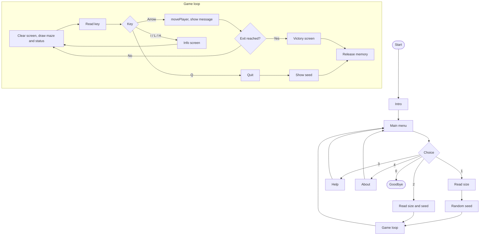

# Maze – Technical Documentation

## 1. Game description

Maze is a console game. The player (`@`) starts at position (0, 0) in the top-left
corner and must reach the exit (`E`) at the bottom-right corner. The maze is shown from
above after every move, so the player always sees the walls, the open corridors, the
keys, the doors and the exit.

### 1.1 Rules

1. The player moves one tile at a time with the arrow keys (or W/A/S/D).
2. The player cannot walk through walls or leave the maze.
3. A key (`k`) is picked up automatically when the player steps on it.
4. A special door (`D`) is a wall that opens with one key. An opened door stays open.
   Every door shortens the way to the exit.
5. The game is won when the player reaches the exit.
6. **Par** is the length of the shortest route without doors. The rating at the end is
   3 stars at or under par, 2 stars up to 50% over par and 1 star otherwise.
7. The player can give up at any time (Q). The seed of the maze is shown so the same
   maze can be replayed from the menu.

The exit can always be reached without doors, so keys and doors are an option for a
better result, not an obstacle.

> The example in the assignment (a grid of numbers with diagonal moves) illustrates one
> possible idea. This project implements the classic variant described in requirements
> 5–8: walls, openings, an exit, arrow-key movement and special doors.

### 1.2 Screens and menu

| Menu option | Description |
|---|---|
| 1. New game | Asks for the size (10–50) and generates a new random maze |
| 2. New game with seed | Asks for size and seed (0–999999) and builds that exact maze |
| 3. How to play | Rules, controls and the meaning of every maze element |
| 4. About | Information about the project |
| 0. Exit | Closes the program |

During the game: `I` inventory, `L` location information, `H` help, `Q` quit.

## 2. Architecture

The code is split into modules. Logic modules never read from or write to the console
(no `cin` / `cout`), which is why they can be tested automatically. All console work is
done in the Frontend modules.



| Layer | Files | Uses cin/cout |
|---|---|---|
| Configuration | `GameConfig.h` | No |
| Backend – maze maintenance | `Maze.h`, `Maze.cpp` | No |
| Backend – game logic and calculations | `Game.h`, `Game.cpp` | No |
| Backend – validation | `Validation.h`, `Validation.cpp` | No |
| Frontend – input | `Input.h`, `Input.cpp` | Yes |
| Frontend – drawing and menus | `Renderer.h`, `Renderer.cpp` | Yes |
| Frontend – program flow | `main.cpp` | Through Input/Renderer |

### 2.1 Coding conventions

| Element | Convention | Example |
|---|---|---|
| Types (`struct`, `enum class`) | PascalCase | `GameState`, `MoveResult` |
| Functions | camelCase, starting with a verb | `movePlayer`, `computeDistances` |
| Variables and parameters | camelCase, meaningful names | `stackRows`, `parMoves` |
| Constants | UPPER_SNAKE_CASE | `MAX_MAZE_SIZE` |
| Files | PascalCase, one module per `.h`/`.cpp` pair | `Renderer.cpp` |
| Header guards | `FILE_NAME_H` | `MAZE_H` |

---

## 3. Backend Developer – `Maze`, `Game`, `Validation`

### 3.1 Data types

```cpp
enum class Tile { Wall, Path, Door, Key, Exit };

struct Position { int row; int col; };

struct Maze {
    int size = 0;          // rows = columns
    Tile** grid = nullptr; // dynamic 2D array
};

struct Player {
    Position pos;          // current position
    int keys;              // keys in the inventory
    int keysCollected, doorsOpened, moves, blockedAttempts;
};

struct GameState {
    Maze maze; Player player;
    unsigned int seed;     // reproduces the maze
    int parMoves;          // shortest route without doors
    bool finished;
};
```

Why these types:

- `enum class Tile` – every tile has exactly one of five meanings; a scoped enum is
  type-safe and needs no "magic" numbers or characters.
- `int` for coordinates and counters – they are small whole numbers and can be negative
  while checking neighbours (for example row −1 is outside the maze).
- `unsigned int` for the seed – the random generator `std::mt19937` expects it.
- `bool` for yes/no states such as `finished`.

### 3.2 Dynamic memory

| Data | Allocation | Release |
|---|---|---|
| Maze grid `Tile**` | `createMaze()` – `new Tile*[size]`, then `new Tile[size]` for every row | `destroyMaze()` |
| Distance grid `int**` | `createDistanceGrid()` | `destroyDistanceGrid()` |
| DFS stack `int*` ×2 | inside `carvePassages()` | end of `carvePassages()` |
| BFS queue `int*` | inside `computeDistances()` | end of `computeDistances()` |
| Candidate list `int*` | inside `placeKeys()` | end of `placeKeys()` |

The size of every array depends on the size chosen by the player (10–50), so the memory
is allocated at run time. `destroyMaze()` sets the pointer to `nullptr`, so calling it
twice is safe. The tests were also run with AddressSanitizer – no leaks or invalid
accesses were found.

### 3.3 Maze generation – randomized depth-first search

Tiles with even row and even column are "rooms". The algorithm starts from room (0, 0),
moves to a random unvisited neighbouring room two tiles away and removes the wall
between them. When there is no unvisited neighbour it goes back (backtracking). A dynamic
array is used as a stack instead of recursion, so even a 50x50 maze cannot overflow the
call stack.



The result is a **perfect maze**: every open tile is reachable and there is exactly one
route between any two tiles. For even sizes the last row and column are not rooms, so
`openExit()` connects the corner to the nearest room and `openBorderNooks()` opens small
dead ends there, so the border looks like the rest of the maze.

The same seed always produces the same maze (`std::mt19937` is a deterministic
generator). Note: the random distributions of the standard library may differ between
compilers, so a seed reproduces the same maze on the same compiler.

### 3.4 Shortest path – Breadth-First Search

`computeDistances(maze, source, allowDoors, distances)` fills a 2D array with the minimum
number of steps from `source` to every tile. Tiles are processed in a queue in order of
distance; every tile enters the queue once, so the queue is a simple array of
`size * size` elements. Unreachable tiles keep the value `UNREACHABLE` (−1).

It is used for:

- `shortestPathLength()` – par of the game
- `distanceToExit()` – location information for the player
- door and key placement

### 3.5 Special doors

`placeDoors(maze, maxDoors, minSaving)`:

1. BFS from the start and from the exit (doors closed).
2. For every wall that separates two open tiles (up/down or left/right), the length of
   the route through that wall is
   `min(fromStart[a] + fromExit[b], fromStart[b] + fromExit[a]) + 2`.
3. The wall with the biggest saving (at least `minSaving` steps) becomes a door. Doors are
   not placed next to each other.

The game uses up to `size / 10` doors (1 for 10x10 … 5 for 50x50) with a minimum saving
of `size / 2` steps.

### 3.6 Keys

`placeKeys()` places one key for every door on a random open tile that is at most half
as far from the start as the door. This keeps the "key + door" route a real option. Keys
are never placed on the start or the exit.

### 3.7 Game logic (`Game.cpp`)

| Function | Purpose |
|---|---|
| `startNewGame(size, seed)` | Allocates and generates the maze, initialises the state |
| `initGame(game, maze, seed)` | Initialises the state for an existing maze (used by tests) |
| `endGame(game)` | Releases the maze memory |
| `getNextPosition(from, direction)` | Neighbouring position in a direction |
| `canMove(game, direction)` | Would a move succeed right now |
| `movePlayer(game, direction)` | Applies the rules and returns a `MoveResult` |
| `isAtExit(game)` | Is the player on the exit |
| `distanceToExit(game)` | Steps left on the shortest route |
| `getStarRating(game)` | 1–3 stars compared to par |



When the move succeeds, the position is updated and `moves` is increased. Blocked
attempts do not count as moves; they are counted in `blockedAttempts`.

### 3.8 Validation (`Validation.cpp`)

| Function | Purpose |
|---|---|
| `trimWhitespace(text)` | Removes spaces, tabs and line breaks at both ends |
| `tryParseInt(text, value)` | Accepts an optional sign and up to 9 digits; rejects empty text, letters, decimals and overflow |
| `isInRange(value, min, max)` | Inclusive range check |
| `isValidMazeSize(size)` | 10–50 |
| `isValidSeed(seed)` | 0–999999 |

`std::stoi` is not used because it accepts "12abc" as 12 and throws exceptions for too
long numbers.

---

## 4. Frontend Developer – `Input`, `Renderer`, `main`

### 4.1 Keyboard (`Input.cpp`)

Arrow keys do not send ordinary characters, and the codes differ between systems:

| System | How a key is read | Arrow codes |
|---|---|---|
| Windows | `_getch()` from `<conio.h>` | first 0 or 224, then 72 ↑ 80 ↓ 75 ← 77 → |
| Linux / macOS | terminal in raw mode (`termios`) | `ESC [ A` ↑ `B` ↓ `C` → `D` ← |

`readKey()` hides these differences with `#ifdef _WIN32` and returns a logical `Key`
(`Up`, `Down`, `Left`, `Right`, `Help`, `Inventory`, `Location`, `Quit`, `Unknown`). The
key is read immediately, without Enter. `keyFromChar()` maps W/A/S/D and the command
letters; it has no input/output and is covered by tests.

`readIntInRange(prompt, min, max, value)` reads a whole line and repeats the question
until `tryParseInt` and `isInRange` accept it, with a clear error message:

```
Enter maze size (10-50): abc
  Invalid input. Please enter a whole number.
Enter maze size (10-50): 5
  Out of range. Please enter a number from 10 to 50.
```

### 4.2 Drawing (`Renderer.cpp`)

Every tile is drawn with two characters, so the maze looks square in the console:

| Element | Symbol |
|---|---|
| Player | `@ ` |
| Wall / frame | `##` |
| Path | two spaces |
| Key | `k ` |
| Door | `D ` |
| Exit | `E ` |

`drawMaze()` builds the whole picture in one `std::string` and prints it at once – this
reduces flickering. `clearScreen()` uses `cls` on Windows and an ANSI escape sequence on
other systems. A 50x50 maze needs a console about 104 characters wide.

| Function | Purpose |
|---|---|
| `showIntro()`, `showMainMenu()` | Introduction and menu |
| `showHelp()` | Rules, controls, all elements |
| `drawMaze(game)` | The maze with the player's position |
| `showStatus(game)`, `showLegend()` | Size, seed, moves, par, keys, legend |
| `showLocationInfo(game)` | Position, distance to exit, open directions |
| `showTileInfo(tile)` | Description of one maze element |
| `showInventory(player)` | Keys and doors |
| `showCommandPrompt()` | List of commands |
| `showVictory(game)`, `showGameAbandoned(game)` | End of game screens |

### 4.3 Program flow (`main.cpp`)



---

## 5. QA

The automated tests and manual test cases are described in
[QA_DOCUMENTATION.md](QA_DOCUMENTATION.md).

## 6. Scrum Trainer

Planning, repository rules and the sprint plan are described in
[PROJECT_PLAN.md](PROJECT_PLAN.md).

## 7. Requirements traceability

| # | Requirement | Implementation |
|---|---|---|
| 1 | Maze game to be won | `movePlayer` → `ReachedExit`, victory screen |
| 2 | Dynamic arrays, size 10x10–50x50 chosen by the player | `createMaze` (`Tile**`), `readIntInRange` + `isValidMazeSize` |
| 3 | Start (0,0), exit bottom-right | `getStartPosition`, `getExitPosition`, `openExit` |
| 4 | Maze shown with the position after every move | game loop in `main.cpp`, `drawMaze` |
| 5 | Text maze, top-down view | `drawMaze` |
| 6 | Walls, openings and exit visible | `getTileSymbol`, `showLegend` |
| 7 | New maze on every run | `generateSeed` + `generateMaze` |
| 8 | Arrow keys; no moving through walls except special doors | `readKey`, `movePlayer`, `placeDoors` |
| 9 | Functions for maintaining and drawing the maze | `Maze.cpp`, `Renderer.cpp` |
| 10 | Logic functions without cin/cout | `Maze.cpp`, `Game.cpp`, `Validation.cpp` |
| 11 | Menu | `showMainMenu`, `main` |
| 12 | Validation of user input | `Validation.cpp`, `readIntInRange` |
